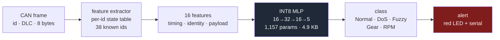

# SecureCAN AI

**A 4.9 KB neural network that watches a car's internal network and spots injected
messages in real time, running on a $5 microcontroller with no cloud connection.**

Built from **17.5 million real CAN frames** recorded off a Hyundai YF Sonata. Detects
four attack classes at an F1 of **0.9994** with a **0.0189%** false-positive rate on a
complete 2.6M-frame held-out split — and the most useful thing in this repo is the
experiment showing why that number is not what it looks like.

---

## The problem

A car's ECUs — engine, transmission, brakes, dashboard — talk over a **CAN bus**. CAN
was designed in 1986 for a sealed metal box, and it has:

- **no sender field.** Any node can claim to be any other node.
- **no authentication or encryption.** There is nowhere in the 8-byte payload to put a
  signature, and no spare bandwidth for extra frames.
- **broadcast delivery.** Every node sees every frame and decides for itself whether to
  act on it.

In 2015 Miller and Valasek drove a Jeep Cherokee off the road from ten miles away, via
the cellular-connected infotainment unit. Chrysler recalled **1.4 million vehicles**.
Retrofitting authentication to CAN is impractical, so the realistic defence for cars
already on the road is to **listen** and raise an alarm.

That has to happen on the vehicle. A 500 kbit/s bus carries about **4,000 frames per
second**, which is **250 µs per frame**. A round trip to a server is tens of
milliseconds at best, and a parked car may have no connectivity at all. Either the
decision is local, or it is too late to matter.

---

## The solution



**It detects. It never blocks.** A false positive that suppressed a real brake or airbag
frame would be far more dangerous than the attack it was trying to stop. The firmware
classifies and reports; a higher-level system decides.

Every stage runs in bounded time and bounded memory. There is no `malloc` anywhere on
the device path — the per-ID table and the network activations are compile-time sized,
and a test enforces it.

---

## Results

All numbers below come from a real run. The command that produced each one is named, so
you can reproduce it.

### Detection on the held-out test set

Features are computed over all 17,558,346 frames in order, so each ID's history stays
continuous. The split is by **time**, never shuffled, because consecutive CAN frames are
strongly correlated and attacks arrive in multi-second bursts — shuffling would put
frames from the middle of one burst in both train and test.

| split | frames | normal frames |
|---|---|---|
| train | 3,241,500 | subsampled to 15% |
| validation | 685,168 | subsampled to 15% |
| **test** | **2,633,758** | **kept complete** |

The test split is deliberately *not* subsampled: FPR is measured per normal frame, so
dropping normal frames there would change the class balance and make the figure
meaningless. `python -m securecan.evaluate`

| model | precision | recall | F1 | false-positive rate |
|---|---|---|---|---|
| rule baseline | 0.9295 | 0.9826 | 0.9553 | 1.1213% |
| random forest | 0.9926 | 1.0000 | 0.9963 | 0.1116% |
| **MLP 16-32-16-5** | **0.9987** | **1.0000** | **0.9994** | **0.0189%** |

Per-class F1: Normal 0.9999 · DoS 1.0000 · Fuzzy 0.9980 · Gear 0.9998 · RPM 0.9993.
Overall accuracy 99.9831%.

### Speed of alarm

| capture | bursts | detected | missed | frames to alert (median / max) |
|---|---|---|---|---|
| DoS | 26 | 26 | 0 | 0 / 0 |
| Fuzzy | 34 | 34 | 0 | 0 / 0 |
| Gear | 21 | 21 | 0 | 0 / 0 |
| RPM | 20 | 20 | 0 | 0 / 0 |

Every burst is caught on its **first injected frame**. As a sanity check on the burst
grouping, the recovered burst durations are 3.50–5.26 s, which independently matches
HCRL's documented 3–5 second injection windows — nothing was tuned to that.

### Quantisation

`python -m securecan.quantize`, evaluated on 120,000 frames.

| | size | accuracy | attack F1 | FPR |
|---|---|---|---|---|
| Keras float32 | 39,544 B | — | — | — |
| TFLite float32 | 6,724 B | 0.999867 | 0.99949 | 0.01534% |
| **TFLite INT8** | **4,968 B** | **0.999883** | **0.99955** | **0.01247%** |

Accuracy change **+0.0017 pp** (INT8 is marginally *better*, which is noise at this
scale), and INT8 agrees with float32 on **99.997%** of frames.

### On the device

`cd firmware/esp32 && pio run` — ESP32-WROOM-32, warning-free with `-Wall -Wextra`.

| | used | available |
|---|---|---|
| RAM | 23,364 B (7.1%) | 327,680 B |
| Flash | 300,120 B (22.9%) | 1,310,720 B |
| model weights | 1,740 B | — |
| network activations | 69 B | — |

> **Per-frame latency on the ESP32 is not yet measured.** It needs a Wokwi account
> token (`WOKWI_CLI_TOKEN`) or real hardware, and this README does not state numbers
> that have not been measured. The firmware reports mean and max µs per frame over
> serial, so `wokwi-cli .` fills this in with one command. For reference, the same
> algorithm in Python on a laptop runs at a median of 74 µs INT8 vs 378 µs float32 —
> useful for the ~5× INT8 speedup, useless as an embedded figure.

### Live demo

`python -m securecan.demo --inject rpm`, 12 s of bus time each, over a `python-can`
virtual bus.

| mode | recall | FPR | precision | burst detected |
|---|---|---|---|---|
| `--inject dos` | 100.00% | 0.107% | 99.81% | yes, 0-frame delay |
| `--inject fuzzy` | 99.03% | 0.188% | 99.45% | yes, 0-frame delay |
| `--inject gear` | 100.00% | 0.205% | 98.82% | yes, 0-frame delay |
| `--inject rpm` | 100.00% | 0.094% | 99.46% | yes, 0-frame delay |
| `--inject rpm --int8` | 100.00% | 0.077% | 99.55% | yes, 0-frame delay |

---

## The part that matters: what is the model actually learning?

An F1 of 0.9994 on a security dataset should make you suspicious, so I went looking.

### Leave-one-attack-out

Train on three attacks, test on the fourth, never seen.
`python -m securecan.evaluate --unseen`

| held-out attack | recall on it |
|---|---|
| DoS | 100.00% |
| Fuzzy | 0.20% |
| **Gear** | **0.00%** |
| **RPM** | **0.00%** |

A model that had learned *"this ID is arriving far too often for its schedule"* would
transfer between the two spoofing attacks — it is the same anomaly aimed at a different
target. **Zero transfer means it learned something else.**

(DoS is the easy case and I don't claim credit for it: it floods ID `0x000`, which this
car never sends, so `is_known_id` catches it on its own.)

### First hypothesis: it memorised `can_id`. Wrong.

The obvious suspect was the ID feature — "0x316 means RPM attack." I ablated it and
re-ran: 100.00% / 0.24% / 0.00% / 0.00%. **Essentially unchanged, so `can_id` was not
the cause.** Worth stating because it was my first guess and the data said no.

### What it really is: one constant payload per campaign

Each HCRL spoofing campaign injected **a single fixed 8-byte payload** for the entire
attack:

| attack | injected payload | injected frames | distinct injected values | distinct *legitimate* values, same ID |
|---|---|---|---|---|
| RPM, `0x316` | `45 29 24 FF 29 24 00 FF` | 654,897 | **1** | 2,297 |
| Gear, `0x43F` | `01 45 60 FF 6B 00 00 00` | 597,252 | **1** | 8,093 |

Memorising one 8-byte constant is a much easier function to fit than a timing model. So
that is what the network did.

**The experiment that settles it.** Take the real attack frames and change *only the
fake value* — identical IDs, identical timing, identical burst structure. Timing-based
detection would be unaffected.

| attack | recall with HCRL's constant | recall with a different value |
|---|---|---|
| RPM, `0x316` | 100.00% | **0.00%** |
| Gear, `0x43F` | 100.00% | **16.28%** |
| DoS, `0x000` | 100.00% | n/a — floods an ID the car never sends, so there is no payload to spoof |

You can watch it happen:

```bash
python -m securecan.demo --inject rpm                   # 100% recall
python -m securecan.demo --inject rpm --novel-payload   # 0% recall
```

### What the shortcut costs on clean traffic

On the attack-free capture (988,871 frames) the overall false-alarm rate is 0.0675% —
but it does not spread evenly:

| CAN ID | frames | false-alarm rate |
|---|---|---|
| `0x4B1` | 25,324 | 1.042% |
| **`0x43F`** | 50,641 | **0.579%** |
| `0x0A0` | 5,068 | 0.237% |

`0x43F` is the Gear attack's target, and **3,681 genuine `0x43F` frames sit one byte
away** from the memorised Gear constant. The model false-alarms on real traffic for
resembling a value it memorised. The demo makes this visible: nearly every false
positive is `0x43F` carrying `01 45 60 FF 6A 00 00 00`, one byte from the attack
constant `...6B...`.

That also explains the asymmetry above — why Gear only fell to 16% while RPM fell to 0%.
The Gear constant sits *inside* the cloud of genuine `0x43F` payloads, so some novel
fake values near it still land in the memorised region; the RPM constant is far from
genuine `0x316` traffic, so a substituted value falls straight out.

### Why this is in the README

**This is a property of the dataset, not of this model.** Any per-frame classifier
trained on these captures can take the same shortcut. Published 99%-plus results on the
HCRL dataset should be read with that in mind — including the ones above.

---

## Honest limitations

1. **Unseen spoofing is not detected.** Substituting only the fake value drops RPM
   recall from 100% to 0%. The model memorised a constant instead of learning the timing
   anomaly. This is the single biggest weakness and it is measured, not hedged.
2. **`0x43F` false-alarms at 0.579%** on genuine traffic, as a direct consequence of (1).
3. **One car, one dataset.** Hyundai YF Sonata. The 38-ID table and the learned periods
   do not transfer to another vehicle without re-learning.
4. **DoS is the easy case.** It floods an ID the car never sends; `is_known_id` alone
   catches it. The 100% there is not evidence of a clever model.
5. **No CAN transceiver in the loop.** Wokwi doesn't model one, so the firmware replays
   real recorded frames from `test_frames.h`. The feature extraction and INT8 inference
   are fully exercised on the real instruction set; the physical layer is not.
6. **Device timings will be from a simulator.** Wokwi runs the same ELF on a cycle-level
   model of the chip, but does not model flash-cache misses or SPI-RAM latency. Expect
   the same order of magnitude on silicon, not the same three digits.
7. **Future work:** train on timing features alone and report the lower, honest number;
   evaluate on ROAD (Oak Ridge), whose injected payloads vary so the shortcut isn't
   available; and measure on real hardware with an SN65HVD230 transceiver.

---

## The 16 features

`src/securecan/features.py` is the single source of truth. `firmware/esp32/src/features.h`
is a direct port, and `tests/test_parity.py` asserts they agree on real frames.

| group | features | what it catches |
|---|---|---|
| timing | `dt_prev`, `dt_same_id`, `period_ratio`, `bus_rate` | injection changes the schedule: a spoofed ID arrives between its legitimate transmissions, so its period collapses |
| identity | `is_known_id`, `id_norm` | Fuzzy sprays IDs the car never uses; DoS floods `0x000` |
| payload | `b0`–`b7`, `dlc`, `payload_changed` | a spoofed value differs from what the real ECU would send |

Three constraints shaped this, and all three are worth being able to explain:

- **No lookahead.** The device sees one frame, must answer, then sees the next. State is
  updated *after* the features are computed — otherwise a frame would see itself and
  `dt_same_id` would always be zero.
- **Fixed memory.** The per-ID table has one slot per ID learned from normal traffic.
  Unknown IDs never get one. That is a security property, not an optimisation: Fuzzy
  sprays random IDs, and a table that grew on demand would be a remote
  memory-exhaustion bug in the defence itself. The *absence* of a slot is what
  `is_known_id` reports.
- **Time is `uint32` microseconds, not float seconds.** A float32 at 1.478e9 has ~128 s
  spacing, so every inter-frame gap would round to zero and half the features would be
  dead. Relative µs also makes the ~71-minute wraparound free: unsigned subtraction
  gives the true elapsed time across the rollover.

---

## Why there is no TensorFlow Lite Micro

The plan was TFLite Micro. Its only ESP32 Arduino packaging,
`tanakamasayuki/TensorFlowLite_ESP32`, was last released in 2021 and does not compile
against the current platform (espressif32 8.x / ESP-IDF 5.5). Three distinct errors:

```
src/screen/.../st7796.c           LCD_IFACE_RELEASE        — removed in IDF 5
src/screen/.../scr_interface.c    gpio_pad_select_gpio     — removed in IDF 5
third_party/flatbuffers/stl_emulation.h:386
    error: assignment of read-only member 'span<T,Extent>::count_'
```

The usual workaround is pinning `platform = espressif32@6.x`, which drags the whole
toolchain back two years and still leaves the project on an abandoned library.

This model is three dense layers and 1,157 parameters, so `firmware/esp32/src/nn.h`
runs them directly — int32 accumulators, per-output-channel requantisation via a
fixed-point multiplier and rounding shift, and ReLU folded into the int8 clamp because
the activations quantise with `zero_point = -128`. About seventy lines, **1,740 bytes of
weights** instead of a 4,968-byte flatbuffer plus a parser plus generic kernels, and no
dependency at all.

Hand-writing inference is only defensible if you then prove it matches, so
`tests/test_parity.py` runs the same real frames through this kernel **and through
TFLite's own int8 interpreter, requiring the predicted class to be identical on every
frame** — not close on average. One disagreement per thousand frames would be four wrong
answers a second on a 500 kbit/s bus.

---

## Parity testing found a real bug

`bus_rate` disagreed between Python and C++ by exactly 1/30 — one frame, on a feature
clipped at 30.

The device keeps time as `uint32` microseconds and evicts with
`(uint32_t)(now - old) > 10000`, which is exact. Python used float64 seconds, where
`0.024 - 0.010` computes to `0.014` but the stored timestamp was
`0.013999999999999999` — a hair *below* the cutoff, so Python discarded a frame the
device kept.

I fixed the **Python** side with a 1 ns epsilon, because the C++ was the correct side,
and 1 ns is 1000× finer than the data's 1 µs resolution, so it cannot change any
decision integer arithmetic would make. Reading the two files side by side would never
have found this.

---

## How to run

```bash
python -m venv .venv && .venv/Scripts/activate      # or source .venv/bin/activate
pip install -r requirements.txt
export PYTHONPATH=src                               # $env:PYTHONPATH="src" on PowerShell
```

```bash
python tools/fetch_dataset.py        # download the HCRL captures (see data/README.md)
python -m securecan.parse            # CSV -> .npz, handles the DLC column shift
python -m securecan.train            # rule + forest + MLP, time-based split
python -m securecan.evaluate         # test metrics, confusion matrices, burst delay
python -m securecan.evaluate --unseen    # leave-one-attack-out + the payload experiment
python -m securecan.quantize         # INT8 PTQ -> results/mlp_int8.tflite
python tools/export_model.py         # -> firmware/esp32/src/model_int8.h
python tools/export_test_frames.py   # -> firmware/esp32/src/test_frames.h
```

```bash
python -m securecan.demo --inject rpm                   # live virtual-bus demo
python -m securecan.demo --inject rpm --novel-payload   # the honest failure case
python -m securecan.demo --inject rpm --int8            # the model that ships
```

```bash
pytest                               # 32 tests, including Python<->C++ parity
cd firmware/esp32 && pio run         # build the ESP32 firmware
wokwi-cli .                          # simulate (needs WOKWI_CLI_TOKEN)
```

The parity tests need a C++ compiler (`g++` or `clang++`); they skip cleanly without one.

---

## Repository layout

```
src/securecan/
  parse.py        HCRL CSV -> arrays. Handles the DLC<8 column shift.
  dataset.py      time-based 70/15/15 splits, never shuffled
  features.py     THE 16 FEATURES -- single source of truth
  train.py        rule baseline + random forest + MLP
  evaluate.py     test metrics, burst delay, leave-one-out, payload experiment
  quantize.py     INT8 post-training quantisation
  demo.py         two-thread live demo on a python-can virtual bus

firmware/esp32/
  src/features.h       port of features.py  (parity-tested)
  src/nn.h             INT8 inference       (parity-tested against TFLite)
  src/model_int8.h     generated weights
  src/constants_data.h generated scalers and learned ID periods
  src/test_frames.h    1,200 real frames with labels
  src/main.cpp         replay loop, serial report, LEDs
  diagram.json         Wokwi circuit
  platformio.ini       no third-party libraries, deliberately

tools/
  fetch_dataset.py     download the captures
  export_model.py      .tflite -> C arrays
  export_test_frames.py
  parity_host.cpp      compiles the real firmware headers for the host

tests/                 32 tests: parsing, features, Python<->C++ parity, NN<->TFLite
notebooks/01_explore.ipynb    what the raw data actually looks like
docs/can_basics.md            CAN protocol and attack taxonomy
docs/interview_qa.md          18 questions with answers that survive follow-ups
```

---

## Dataset

**HCRL Car-Hacking Dataset** (Hyundai Yonsei Car-Hacking Research Lab), recorded from a
real **Hyundai YF Sonata** via the OBD-II port. Download instructions in
[`data/README.md`](data/README.md).

| capture | frames | injected |
|---|---|---|
| DoS | 3,665,771 | 587,521 |
| Fuzzy | 3,838,860 | 491,847 |
| Gear | 4,443,142 | 597,252 |
| RPM | 4,621,702 | 654,897 |
| attack-free | 988,871 | 0 |
| **total** | **17,558,346** | **2,331,517** |

Three parsing traps, all pinned by tests in `tests/test_parse.py`:

1. **No header row**, and the columns must be inferred.
2. **Rows with `DLC < 8` shift the flag column left** by `8 - DLC`. A fixed-column read
   picks up a data byte where the label should be, and silently labels injected frames
   as normal.
3. **The attack-free capture uses a different format** from the four attack captures.

And one trap in the *content*: HCRL stopped injecting before each recording ended, so
**20–27% of every attack capture is attack-free, at the end**. Splitting by time without
noticing that would put a mostly-clean block in the test set and flatter every number
downstream. [`notebooks/01_explore.ipynb`](notebooks/01_explore.ipynb) has the plot.

---

## Tech stack

Python 3.12 · TensorFlow 2.20 (training + INT8 PTQ) · scikit-learn (forest baseline) ·
NumPy · python-can (virtual bus) · C++17 · PlatformIO / Arduino-ESP32 · Wokwi ·
pytest

---

## License

MIT
